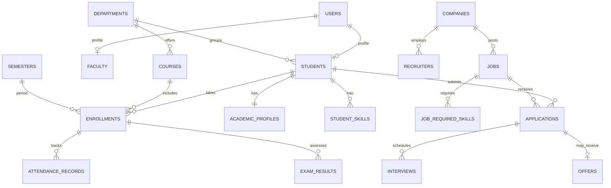

# Database schema and DBMS notes

The original schema is retained: `users`, `departments`, `students`, `faculty`, `semesters`, `courses`, and `enrollments`, with the existing student view, indexes, enrollment audit objects, procedures, function, and constraint demonstration. The app does not recreate the database or delete existing tables.

The new migration adds:

- `academic_profiles` (one-to-one student CGPA, 10th/12th percentages, and active backlog totals) and `student_skills` (one row per student and skill).
- `attendance_records` and `exam_results`, linked to existing enrollment rows and recording the responsible user.
- `companies`, `recruiters`, `jobs`, and `job_required_skills` for normalized recruitment data.
- `applications` with one application per student/job, `interviews` with one numbered round per application, and `offers` with one offer record per application.
- Foreign keys, uniqueness constraints, range checks, and indexes for report and lookup paths.

The application assumes a 10-point CGPA scale. The migration runner verifies all seven original core tables exist before applying additive `.sql` files and records completed versions in `schema_migrations`. It does not inspect or alter the definitions of existing tables. The audit migration creates the audit table if missing and creates the three named enrollment triggers only when those trigger names are absent; existing triggers are retained. Review the connected database with `SHOW CREATE TABLE`, `SHOW TRIGGERS`, `SHOW PROCEDURE STATUS`, and `SHOW FUNCTION STATUS` before applying migrations.

The existing enrollment audit trigger records enrollment insert/update/delete events. SQL demo files that could modify records are not run by the Flask app. The transaction demo and trigger test statements are commented by default; use disposable records in a test database when demonstrating them. `EXPLAIN` the job, application, and dashboard queries against representative data before adding further indexes.
